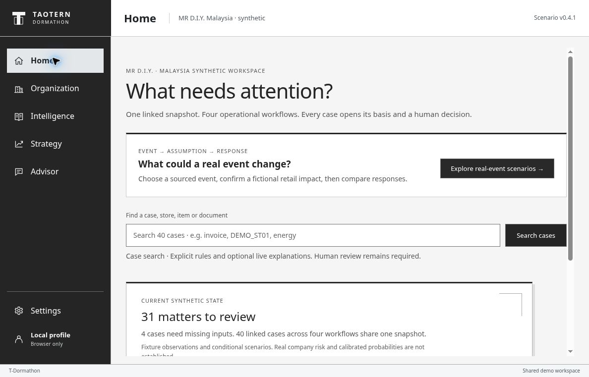
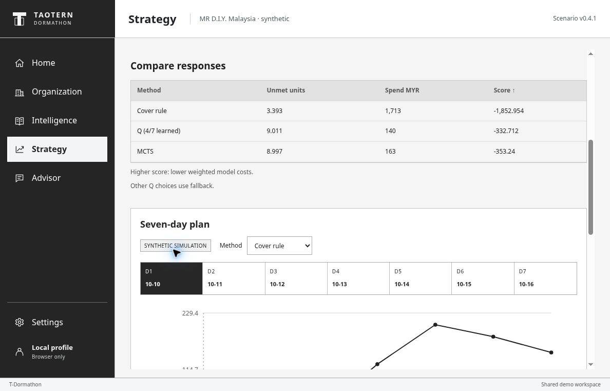
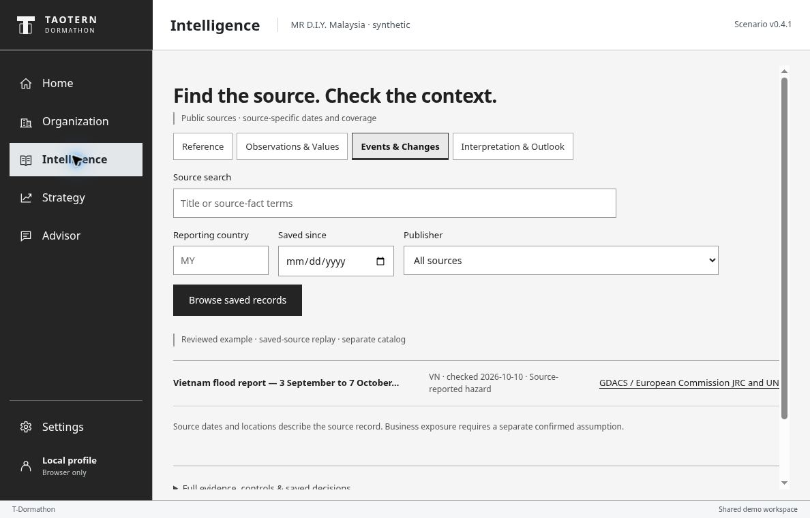
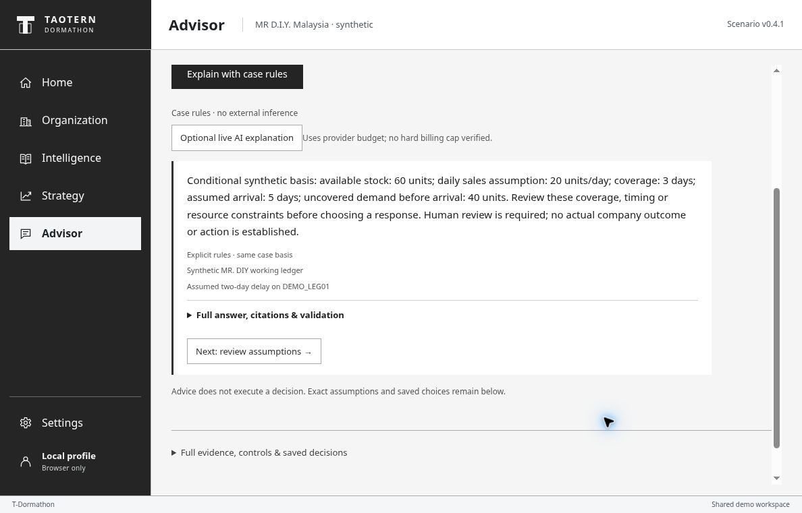

# T-Dormathon

**Turn public evidence into explicit operational assumptions, compare responses, and keep the decision with a human.**

An English-first decision-support prototype by **Taotern**, using MR D.I.Y. Malaysia as a reference scenario. Public source evidence is kept separate from fictional internal operations and simulated outcomes.

[Open the public demo](https://dormathon-risk-private-20261007.liuyz8715.chatgpt.site/workbench.html) · [Documentation](docs/README.md) · [Product specification](docs/specs/Dormathon_Product_Specifications_v0.4.1_EN.md)

The demo opens without login. The hostname contains “private” for historical reasons; the current demo is public. This README describes the v82 interface, reviewed on 10 October 2026.



## What it does

Operations teams need to distinguish what happened, what it could affect, and which response is feasible. T-Dormathon connects those steps in five views:

- **Home:** find a case or start an event-led scenario.
- **Organization:** inspect 40 synthetic cases across supply, procurement, service and energy continuity, including missing-input paths.
- **Intelligence:** search saved public-source records and inspect source dates, coverage and immutable evidence.
- **Strategy:** confirm a hypothetical shipment delay, compare seven-day responses, inspect MCTS root actions, replay synthetic history and try a model refit.
- **Advisor:** explain the selected case with explicit rules and citations. An optional live AI explanation is a separate, budget-consuming action.

Saved choices record a human plan; they do not place orders, move money, assign staff or operate equipment.

## Try it in three minutes

1. Open **Home → Explore real-event scenarios**.
2. Choose **US-Iran conflict and Hormuz disruption**. Read the dated source fact, enter **3** fictional delay days, and confirm the exposure assumption.
3. Select **Compare responses**. Compare unmet units, spend in MYR and score, then inspect a timeline day. Higher score means lower weighted model costs, not higher probability.
4. Open **MCTS search → Inspect actual search**, then **Learning & history** for the 60-day synthetic replay.
5. Open **Organization → SC01**, then **Advisor → Explain with case rules**. The explanation uses the selected case, separately from the event simulation.

This route requires no provider call. See the [demo guide](docs/DEMO.md) for further checks and known UI limits.

## Screenshots

**Strategy:** conditional response comparison and seven-day timeline.



**Intelligence:** source search and clearly separated reviewed examples.



**Advisor:** the rule-based explanation of stock coverage, arrival and uncovered demand.



## Presentation

The team presentation package is delivered separately as **Dormathon_Team_Presentation_Complete_v82.zip**. Use that attachment for the presentation files and runbooks. Earlier deck editions and screenshots retain their own version labels; they are not relabeled as v82.

## Run and verify the source

Use **Node.js 24.x**; Node 24.19.0 on Linux is the verified baseline. From the repository root:

```sh
node --version
npm run build
npm test
npm run verify:artifact
```

These build/test commands use Node's built-in facilities, including `node:sqlite`; they need no account, API key, network or dependency installation. The build produces `dist/server/index.js` and `dist/.openai/hosting.json`.

Repository verification on Node 24.19.0/Linux, including the test-only v82 asset allowlist correction: **783/783 tests pass** and artifact validation checks all **42 static assets**. This local verification does not assert a new deployment.

Additional checks:

```sh
npm run test:sources
npm run verify:data
npm run verify:local
npm run verify:handoff
```

**Running the web app:** the supported runtime is a GPT-Site ESM Worker with a persistent D1 binding named `DB`. Use the public demo for an immediately runnable UI. The repository does not supply an `npm start`/`npm run dev` server or a Docker deployment. A static file server alone will not run its backend. Publishing requires the existing Site's authorized deployment workflow; a source clone does not copy hosted data, credentials or deployment rights. `npm ci` is needed for Drizzle schema-development tooling, not the offline checks above.

## Architecture and project layout

Browser UI and on-demand simulation WebWorkers → Worker API → D1 persistence. The source pipeline retains versioned evidence separately from synthetic case state and saved human choices.

- `static/` — interface and browser simulation modules
- `worker/` — API, source retrieval, case mechanics, planning and Advisor
- `db/`, `drizzle/`, `lib/` — schema, migrations and supporting code
- `data/`, `datasets/` — public-source policies, retained inputs and labeled fixtures
- `scripts/`, `tests/` — build, reproducibility and regression checks
- `local-collector/`, `source-packs/` — deterministic collection and source-specific programs
- `contracts/`, `docs/` — interfaces, specifications and evidence

## What the demo does not prove

- MR D.I.Y. is a reference company, not a claimed customer or endorser. Internal records, exposure assumptions and the 60-day replay are synthetic.
- Q-learning, MCTS and PINN components are implemented. The corrected heldout comparison does **not** establish Q/MCTS superiority over the stronger controller; the PINN offers no accuracy advantage over the exact RC solver here. Training checkpoints are not 60 days of actual online learning.
- Forecast studies do not establish actual company accuracy, calibrated risk probabilities, causal effects or realized savings.
- Source search is indexed term retrieval, not comprehensive live world coverage. Optional live AI is distinct from source retrieval and from deterministic case rules.
- There is no autonomous operational execution or verified production daily scheduler. The app's provider-budget guard is not a verified provider billing hard cap.

## Team, contribution and history

Maintained for the **Taotern** project. Follow the [current specification](docs/specs/Dormathon_Product_Specifications_v0.4.1_EN.md) and versioned [contracts](contracts/). Keep source facts, assumptions and outcomes explicitly separate; run the checks above when changing behavior.

Older specifications, handoffs and release evidence remain available through the [documentation index](docs/README.md). The [previous README](docs/history/README-before-v82-cleanup.md) is archived rather than discarded. Historical staffing statements are not current assignments. Existing team code and Git history are preserved.

Public datasets retain source-specific license and attribution requirements; see their individual READMEs and policies. Public demo access does not grant a blanket license to redistribute every retained dataset.
